# MomentBox — Nhật ký Khoảnh khắc Đa phương tiện, Cộng đồng & Chat Realtime

-3DDC84?logo=android&logoColor=white)


**MomentBox** (*"Lưu giữ mọi khoảnh khắc"*) là ứng dụng Android hoàn chỉnh gồm **23 màn hình chức năng + 3 trạng thái/biến thể** (S01 → S23), xây dựng theo chuẩn đào tạo Android thuần **Kotlin + XML View + ViewBinding + Material 3**, phủ đầy đủ **19 hạng mục kiến thức nền tảng đến hệ thống** của [Tài liệu BA](MomentBox_Tai-lieu-BA.docx): từ kiến trúc MVVM, Generic, Coroutines/Flow, OkHttp/Retrofit `TokenAuthenticator`, RecyclerView đa `viewType` + payload, Room `FTS4`, Custom View Canvas tối ưu `0` allocation, CameraX + Matrix Crop + Multi-touch/Drag & Drop Editor, Foreground Service ghi âm, cho đến Socket.IO realtime, **AIDL IPC chạy tiến trình riêng `:player`**, `AlarmManager` + Full-screen Reminder, Dark Mode, đa ngôn ngữ (`vi` / `en` / `ja`) và kiểm toán bảo mật bản Release.

<table>
  <tr>
    <td align="center">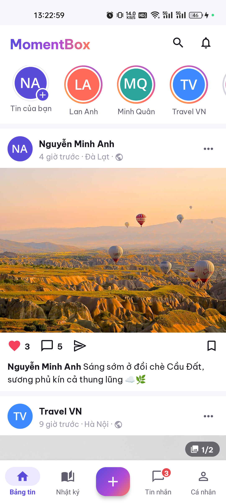<br/><sub><b>S04 · Bảng tin đa kiểu</b></sub></td>
    <td align="center">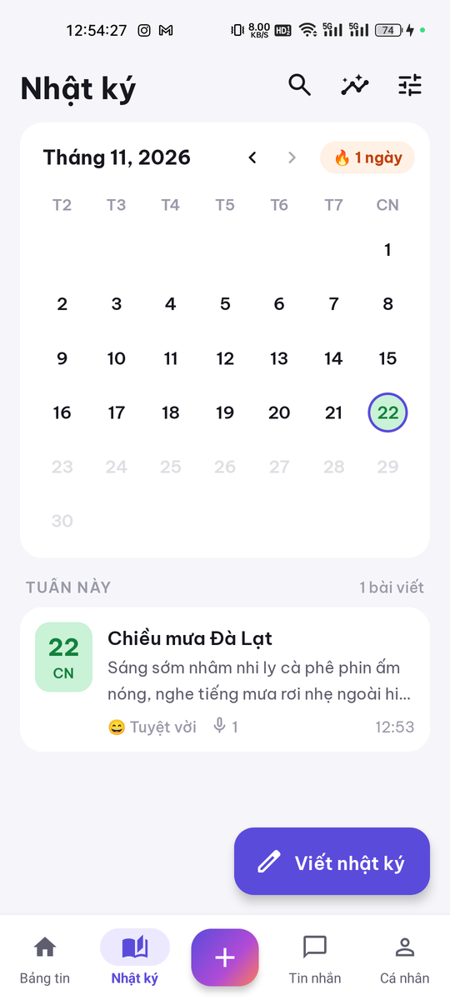<br/><sub><b>S07 · Lịch cảm xúc (Room)</b></sub></td>
    <td align="center">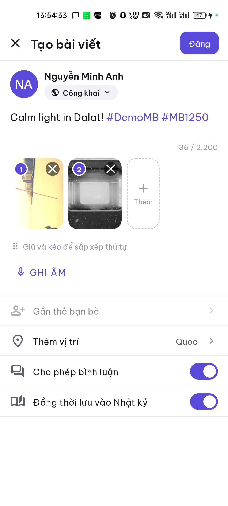<br/><sub><b>S15 · Tạo bài viết</b></sub></td>
    <td align="center">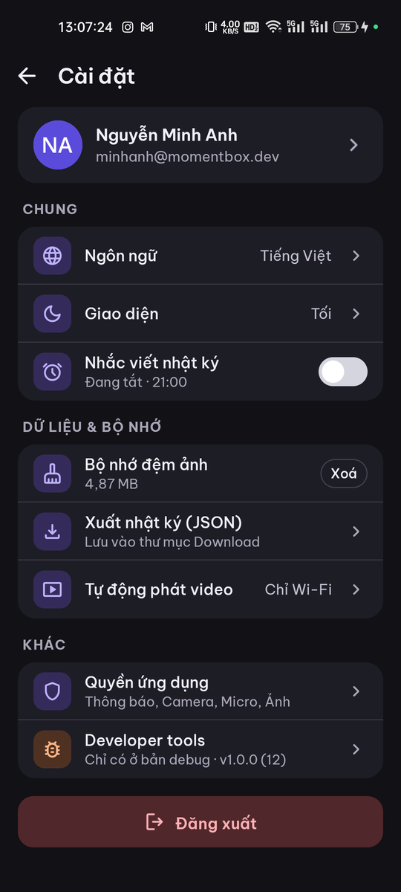<br/><sub><b>S22 · Cài đặt (Dark Mode)</b></sub></td>
  </tr>
</table>

> Toàn bộ ảnh chụp màn hình và 5 video demo bên dưới được ghi trực tiếp ngày **26–27/11/2026** từ ứng dụng thật chạy trên **Realme RMX3350** (Android 13, có camera & micro phần cứng), kết hợp **AVD Pixel 6a** (Android 14) cho luồng chat realtime 2 thiết bị và bố cục 2 cột `layout-sw600dp` (`960×660dp`, `sw660dp`).

---

## Mục lục

1. [Kiến trúc hệ thống](#1-kiến-trúc-hệ-thống)
2. [Công nghệ sử dụng](#2-công-nghệ-sử-dụng)
3. [Demo chi tiết 5 Milestone (Ảnh thật & Video YouTube)](#3-demo-chi-tiết-5-milestone-ảnh-thật--video-youtube)
4. [Kết quả nghiệm thu chi tiết theo Tài liệu BA](#4-kết-quả-nghiệm-thu-chi-tiết-theo-tài-liệu-ba)
5. [Cấu trúc Repository](#5-cấu-trúc-repository)
6. [Hướng dẫn Cài đặt & Chạy ứng dụng](#6-hướng-dẫn-cài-đặt--chạy-ứng-dụng)
7. [Kiểm thử & Bảng số liệu chất lượng](#7-kiểm-thử--bảng-số-liệu-chất-lượng)
8. [Điểm nhấn Bảo mật & Engineering](#8-điểm-nhấn-bảo-mật--engineering)
9. [Tài liệu liên quan](#9-tài-liệu-liên-quan)

---

## 1. Kiến trúc hệ thống

Ứng dụng áp dụng kiến trúc **MVVM một chiều** kết hợp **Manual Dependency Injection** tập trung tại [`MomentBoxApp`](MomentBox_App/app/src/main/java/com/ntq/training/momentbox/MomentBoxApp.kt), hỗ trợ chuyển đổi linh hoạt **3 nguồn dữ liệu** (`MB Server`, `DummyJSON`, `Offline`) và tách riêng tiến trình phát nhạc `:player` giao tiếp qua **AIDL IPC**.

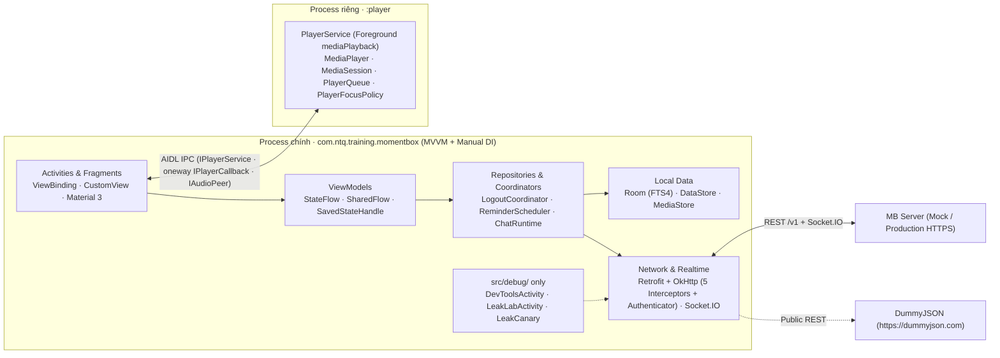

---

## 2. Công nghệ sử dụng

| Lớp / Thành phần | Công nghệ & Phiên bản thực tế |
|---|---|
| **Nền tảng & Build** | Kotlin, Android Gradle Plugin `9.2.0`, KSP `2.3.12`, `compileSdk / targetSdk 36`, `minSdk 24`, Java `17` + Core Library Desugaring `2.1.4` |
| **Giao diện (UI)** | Android XML Views, ViewBinding, Material Components `1.12.0`, `ConstraintLayout 2.2.0`, `RecyclerView 1.4.0`, `ViewPager2 1.1.0`, `SwipeRefreshLayout 1.1.0`, `Core SplashScreen 1.0.1`, 7+ Custom Views vẽ bằng Canvas |
| **State & Bất đồng bộ** | `Lifecycle / ViewModel / ProcessLifecycle 2.8.7`, `Kotlin Coroutines & Flow 1.10.1`, `DataStore Preferences 1.1.2` |
| **Mạng & Realtime** | `Retrofit 2.11.0`, `OkHttp 4.12.0`, `Gson 2.11.0`, `Socket.IO Client 2.1.1` (tương thích Socket.IO Server 4.x) |
| **Lưu trữ cục bộ** | `Room 2.6.1` (7 bảng + tìm kiếm toàn văn `FTS4` + `@Transaction` + `exportSchema = true`), `MediaStore` / `ContentResolver` + `ContentObserver` |
| **Media & Chạy nền** | `CameraX 1.5.3` (`Preview`, `ImageCapture`, `VideoCapture`, `ImageAnalysis`), `Media3 ExoPlayer 1.5.1` (MP4 & HLS), `Glide 4.16.0`, `ExifInterface 1.4.2`, `MediaRecorder`, `AudioTrack` (`MODE_STATIC` & `MODE_STREAM`), `AIDL`, `AlarmManager`, `Notification` (5 channels) |
| **Kiểm thử & Debug** | `JUnit 4.13.2`, `kotlinx-coroutines-test 1.10.1`, `OkHttp MockWebServer 4.12.0`, `Espresso 3.6.1`, `LeakCanary 2.14` (`debugImplementation` only) |
| **Mock Backend** | Node.js `>= 18`, `Express 4.22.3`, `Socket.IO 4.8.4`, `Multer 2.4.0`, `CORS 2.8.6` |

---

## 3. Demo chi tiết 5 Milestone (Ảnh thật & Video YouTube)

> **Cách xem video demo:** Bấm nút **YouTube** ở từng Milestone để xem trực tuyến ngay trên trình duyệt (không cần tải về).

### Milestone 1 — Nền tảng & Xác thực (S01 → S03)

- **Phạm vi:** `SplashActivity` (SplashScreen API, đọc song song `config` + `DataStore`), `OnboardingActivity` (`ViewPager` + `PagerAdapter` tự viết, `PageIndicatorView` co giãn theo `positionOffset`, đổi ngôn ngữ giữ đúng trang), `AuthActivity` (validate inline, `KEY_PASSWORD_VISIBLE` + `saveEnabled="false"`, chạm ngoài ẩn bàn phím, đăng nhập Demo, `TokenAuthenticator` đồng bộ chống gọi refresh trùng).
- **Video demo chi tiết:** [](https://www.youtube.com/watch?v=NQhp4vfBxmc)
  - *Nội dung trong video:* Khởi động sạch app (S01 Splash) → vuốt S02 Onboarding xem `PageIndicatorView` → đổi ngôn ngữ Tiếng Việt ↔ English ↔ Tiếng Việt giữ nguyên trang 2 → hoàn tất onboarding sang S03, mở lại app đi thẳng S03 → kiểm tra validate inline email/mật khẩu → bấm Tài khoản demo đăng nhập Nguyễn Minh Anh vào thẳng Bảng tin S04.

<table>
  <tr>
    <td align="center">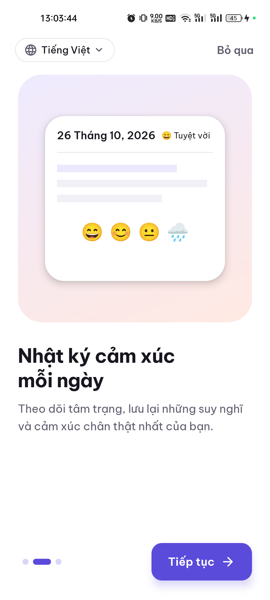<br/><sub><b>S02 · Onboarding (`ViewPager` + `PageIndicatorView`)</b></sub></td>
    <td align="center">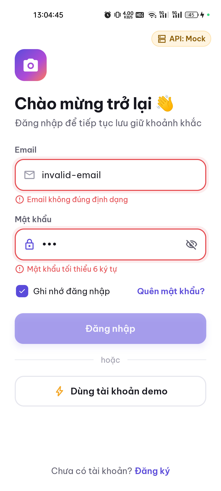<br/><sub><b>S03 · Đăng nhập (Validate + Chip nguồn API debug)</b></sub></td>
  </tr>
</table>

---

### Milestone 2 — Bảng tin, Bình luận & Video (S04, S04b, S05, S06)

- **Phạm vi:** `FeedFragment` (`RecyclerView` 7 `viewType`, `ListAdapter` + `DiffUtil` + payload cập nhật tim không nháy ảnh, `RecycledViewPool` dùng chung cho list ngang Story & Gợi ý, 1 `ExoPlayer` auto-play + 1 `MediaPlayer` voice), `PostDetailActivity` (so sánh Layout A `NestedScrollView` vs Layout B `ConcatAdapter`, phân trang bình luận + phản hồi, chống gửi trùng `clientId` khi retry, `mergeServerPage` chống race condition), `VideoPlayerActivity` (Media3 ExoPlayer MP4/HLS, `layout-land` riêng, Replay & bàn giao vị trí về Feed).
- **Video demo chi tiết:** [](https://www.youtube.com/watch?v=aUk7dGmkJ0s)
  - *Nội dung trong video:* Lướt thanh Story, bấm Like/Bookmark trên Bảng tin S04 → chuyển tab Nhật ký rồi quay lại giữ nguyên trạng thái → mở S05 Chi tiết bài viết, đổi sắp xếp *Mới nhất*, gửi bình luận & phản hồi tiếng Anh (`Nice photo! Love it! #MB1250` và `@Nguyễn Minh Anh Epic vibe! Count me in!`) → mở S06 VideoPlayer (HLS `.m3u8`) chuyển toàn màn hình xoay ngang `layout-land`, chọn tốc độ & tua nhanh +10s rồi quay lại Feed → phát bài Thoại trên Feed và đổi tốc độ phát (`1x / 1.5x / 2x`).

<table>
  <tr>
    <td align="center"><br/><sub><b>S04 · Bảng tin đa `viewType`</b></sub></td>
    <td align="center">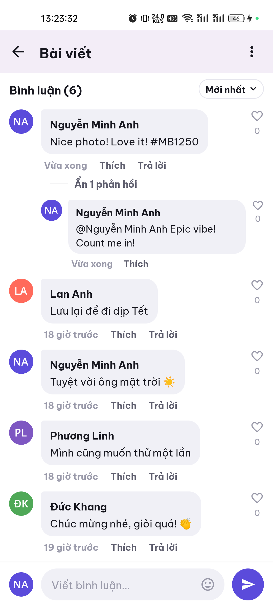<br/><sub><b>S05 · Chi tiết bài viết & Bình luận</b></sub></td>
    <td align="center">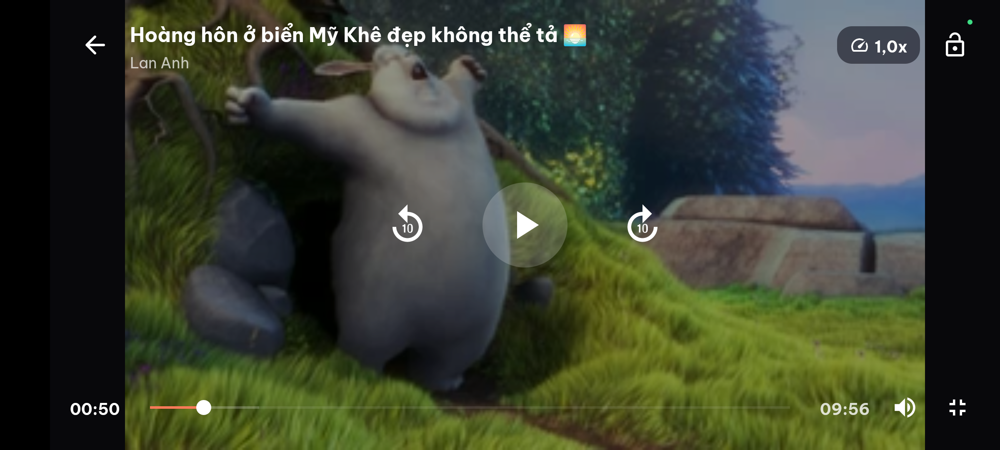<br/><sub><b>S06 · Trình phát video (`layout-land`)</b></sub></td>
  </tr>
</table>

---

### Milestone 3 — Nhật ký cá nhân & Thống kê (S07, S07b, S08, S09)

- **Phạm vi:** Offline hoàn toàn trên Room (`journal_entries`, `journal_attachments`, `journal_tags`, `FTS4`), `MoodCalendarView` tự vẽ Canvas + `onSaveInstanceState`, `S07b` Lọc/Sắp xếp chạy SQL kèm đếm trước `SELECT COUNT(*)`, `S08` Soạn nhật ký (tự lưu nháp JSON vào DataStore + hộp thoại khôi phục nháp, `@Transaction`, âm thanh nền `AudioTrack MODE_STREAM`, đính kèm ghi âm thật), `S09` `JournalStatsCalculator` thuần Kotlin trên `Dispatchers.Default` + `DonutChartView` & `LineChartView` (`0` cấp phát trong `onDraw`).
- **Video demo chi tiết:** [](https://www.youtube.com/watch?v=HpAapzusMYE)
  - *Nội dung trong video:* Mở S08 kiểm tra chặn lưu bài trống, viết nhật ký `Dalat Trip MB1250` (chọn cảm xúc *Tuyệt vời*, kiểm tra tự lưu nháp & khôi phục nháp, đính kèm ảnh từ `MomentBoxDemo`, ghi âm giọng nói thật 28 giây và phát lại xem thanh sóng tiến độ & bộ đếm giây trực tiếp, bật âm thanh nền *Tiếng mưa* `MODE_STREAM`, lưu) → về S07 thấy lịch cảm xúc 3 ngày liên tiếp (`24–26/11/2026`), thử ghim bài, vuốt xóa + Hoàn tác trong 5s, tìm kiếm `Dalat`, lọc S07b (`Có ảnh: 3`, `Có ảnh + Có ghi âm: 1`) → mở S09 Thống kê xem biểu đồ `DonutChartView` & `LineChartView`.

<table>
  <tr>
    <td align="center">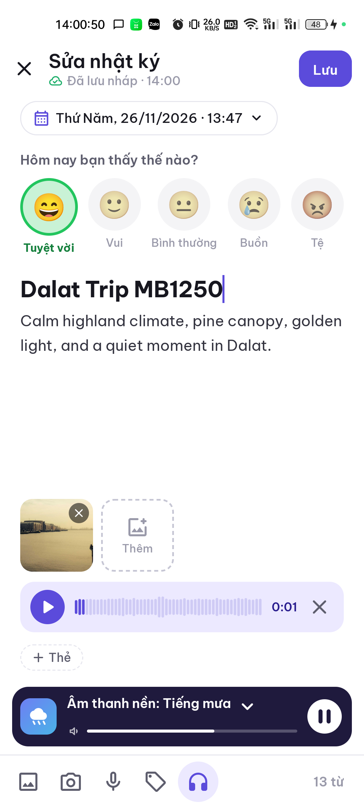<br/><sub><b>S08 · Viết nhật ký & Âm thanh nền `MODE_STREAM`</b></sub></td>
    <td align="center"><br/><sub><b>S07 · `MoodCalendarView` & Danh sách Room Flow</b></sub></td>
    <td align="center">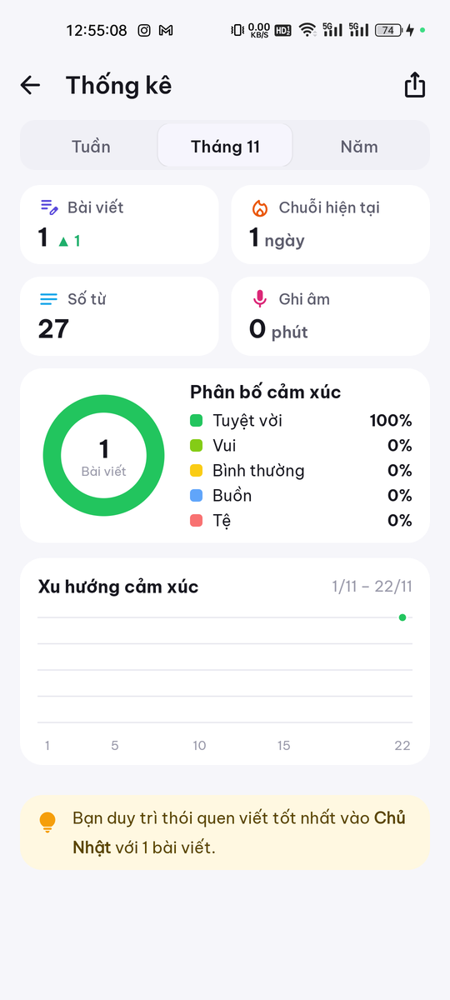<br/><sub><b>S09 · Thống kê (`DonutChartView` & `LineChartView`)</b></sub></td>
  </tr>
</table>

---

### Milestone 4 — Media & Tạo bài viết (S10 → S15)

- **Phạm vi:** `CreateActivity` quản lý back stack Fragment + Fragment Result API: **S10** Gallery tự viết trên `MediaStore` + `ContentObserver` (`callbackFlow`), **S11** CameraX + bộ lọc realtime `ImageAnalysis` tái sử dụng Bitmap + `AudioTrack MODE_STATIC`, **S12** `CropOverlayView` dùng `Matrix` nghịch đảo & khóa tỷ lệ `1:1`/`4:5`/`16:9`/`3:4` khi kéo cạnh + giải mã `inSampleSize`, **S13** `StickerCanvasView` multi-touch (`pointerId`) + Drag & Drop framework + Undo/Redo đồng bộ SeekBar + lưu `MediaStore` (`IS_PENDING`), **S14** `RecordingService` Started + Bound Foreground Service (`microphone`) + `AudioDeviceCallback` nhận diện phần cứng `RMX3350`, **S15** Compose upload multipart `ProgressRequestBody` + chống đăng trùng `clientId` + đồng thời lưu vào Nhật ký.
- **Video demo chi tiết:** [](https://www.youtube.com/watch?v=ZYFtP_t0qkY)
  - *Nội dung trong video:* Mở S11 CameraX đổi bộ lọc realtime (*Ấm*, *Đen trắng*) & chạm lấy nét trên camera thật RMX3350 → mở S10 Gallery chuyển album `MomentBoxDemo` chọn/bỏ chọn đổi thứ tự 2 ảnh (`Tiếp (2)`) → S12 Crop khóa tỷ lệ `1:1` + xoay 90° + lật ngang → S13 Editor vẽ nét, Undo/Redo, chỉnh Sáng/Tương phản/Bão hòa & lưu → S15 Compose viết `Calm light in Dalat! #DemoMB #MB1250` + chip quyền riêng tư *Công khai* + bật *Đồng thời lưu vào Nhật ký* → đăng lên đầu Bảng tin & đồng bộ sang Nhật ký → mở S14 Ghi âm bằng micro thật `RMX3350` thử tạm dừng/tiếp tục (`00:04.4 → 00:07.0`).

<table>
  <tr>
    <td align="center">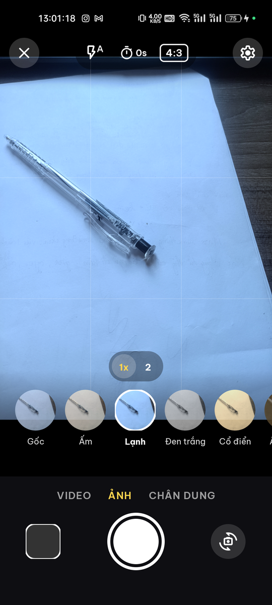<br/><sub><b>S11 · CameraX & Bộ lọc realtime</b></sub></td>
    <td align="center">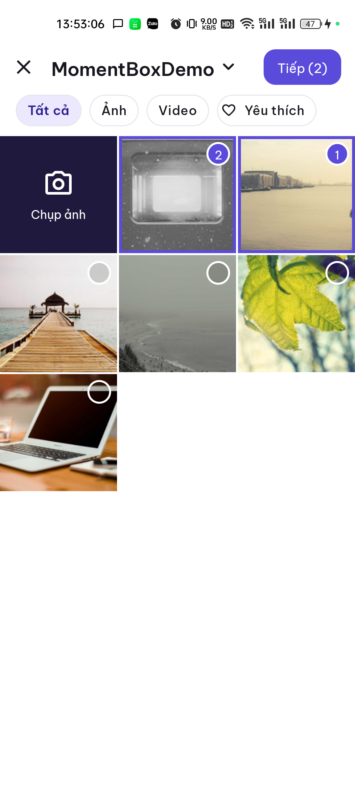<br/><sub><b>S10 · Thư viện `MediaStore`</b></sub></td>
    <td align="center">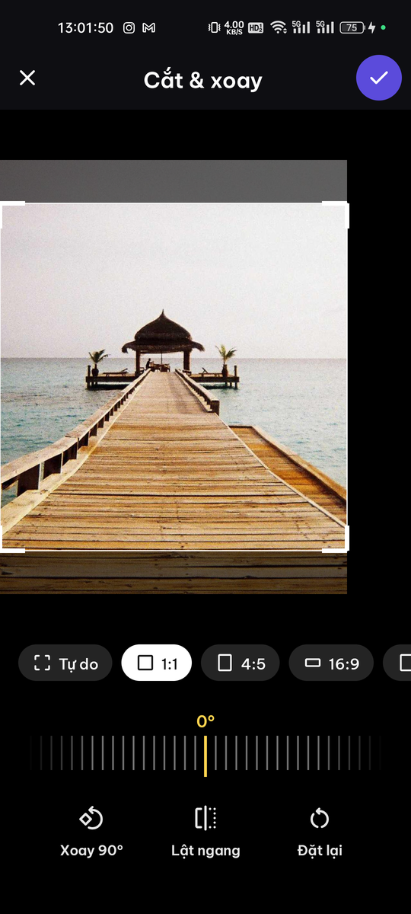<br/><sub><b>S12 · Crop `Matrix` khóa tỷ lệ `1:1`</b></sub></td>
  </tr>
  <tr>
    <td align="center">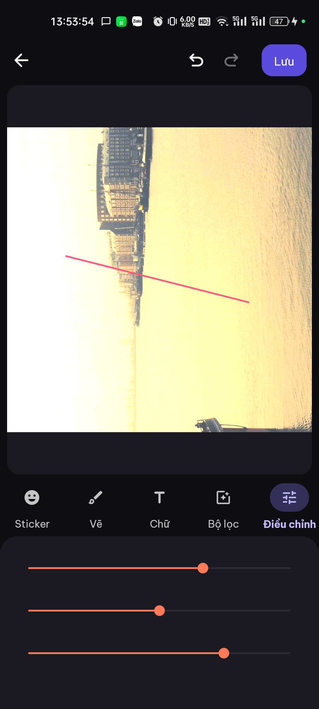<br/><sub><b>S13 · Sticker / Vẽ / Điều chỉnh / Undo</b></sub></td>
    <td align="center"><br/><sub><b>S15 · Tạo bài viết & Multipart Upload</b></sub></td>
    <td align="center">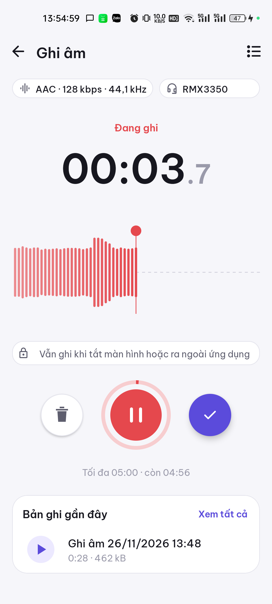<br/><sub><b>S14 · Ghi âm (`RMX3350` Foreground Service)</b></sub></td>
  </tr>
</table>

---

### Milestone 5 — Realtime Chat, AIDL `:player`, Reminder, Profile, Settings & DevTools (S16 → S23)

- **Phạm vi:** **S16–S17** Socket.IO (`RealtimeSocket`, `CloseAwareWebSocketFactory`, `generation` fence, Direct Reply fallback REST, thích ứng 2 cột `layout-sw600dp`), **S18** `PlayerService` chạy tiến trình riêng `android:process=":player"` giao tiếp AIDL (`oneway` callback, `RemoteCallbackList`, `enforceOwner()`, bắt tay AudioFocus bằng `nonce`), **S19–S20** 5 kênh thông báo & Daily Reminder (`ReminderScheduler` dùng `Mutex`, `EXACT`/`INEXACT` fallback, `ReminderRescheduleReceiver` dùng `goAsync()`, bảo toàn lịch khi đổi ngôn ngữ), **S21** Profile `ViewPager2` + `QuarterBlurTransformation`, **S22–S22b** Dark Mode, đa ngôn ngữ (`vi`/`en`/`ja`), Export JSON (`ExportInstantAdapter`), `LogoutCoordinator` cấp Application, **S23** `DevToolsActivity` & `LeakLabActivity` cách ly 100% trong `src/debug/`.
- **Video demo chi tiết:** [](https://www.youtube.com/watch?v=TeUrmXBtDQI)
  - *Nội dung trong video:* S16–S17 Chat realtime 2 thiết bị (RMX3350 Minh Anh ↔ AVD Pixel 6a Hà Trang: badge chưa đọc `3 → 4`, trạng thái đã xem `✓✓`, bong bóng báo lỗi `#fail` kèm thử gửi lại) → mở S18 Player từ biểu tượng mic trên nhật ký `Dalat Trip MB1250` phát bản ghi âm qua process riêng `:player` (`AIDL bound · focus=GAIN`, 2 PID độc lập) → mở S21 Profile vuốt 3 tab `ViewPager2` (bài mới đăng M4 hiển thị đầu lưới) → vào S22 Settings bật **Dark Mode**, đổi ngôn ngữ **Tiếng Việt ↔ English ↔ Tiếng Việt**, xuất nhật ký JSON (`momentbox_journal_20261126.json`) → mở **S23 Developer tools** kích hoạt giả lập `401 → refresh → 200`, xem Network Log, trạng thái Socket.IO, Glide cache và Leak Lab.

<table>
  <tr>
    <td align="center">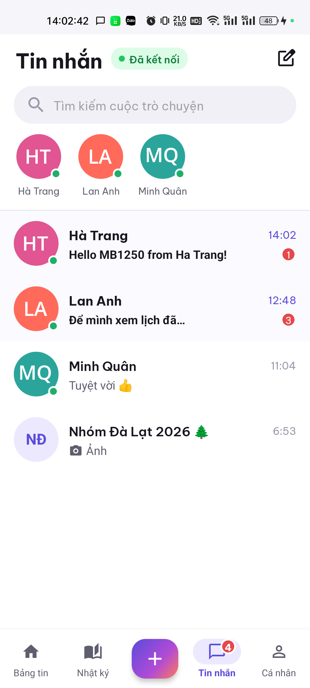<br/><sub><b>S16 · Chat Realtime (Socket.IO)</b></sub></td>
    <td align="center">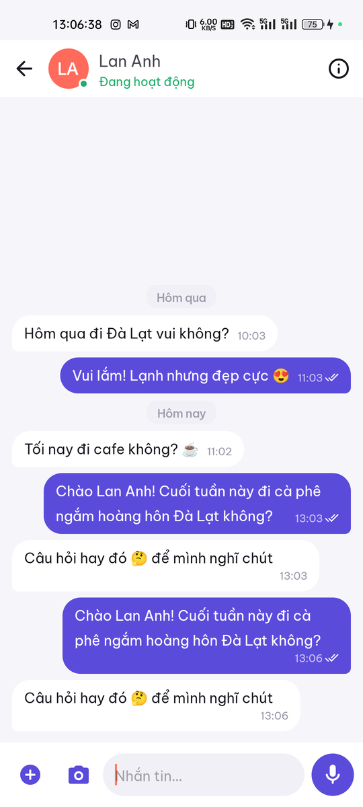<br/><sub><b>S17 · Phòng chat 2 thiết bị &amp; lỗi `#fail`</b></sub></td>
    <td align="center">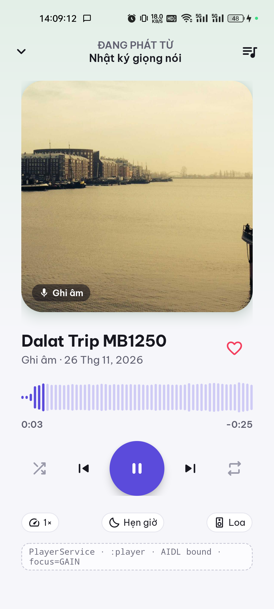<br/><sub><b>S18 · Player (`:player` · AIDL bound)</b></sub></td>
  </tr>
  <tr>
    <td align="center">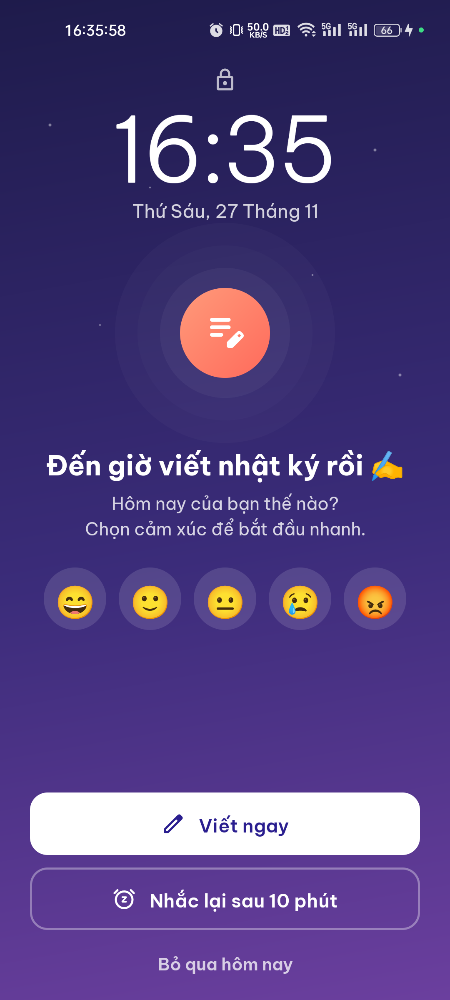<br/><sub><b>S20 · Nhắc viết nhật ký (Full-screen)</b></sub></td>
    <td align="center">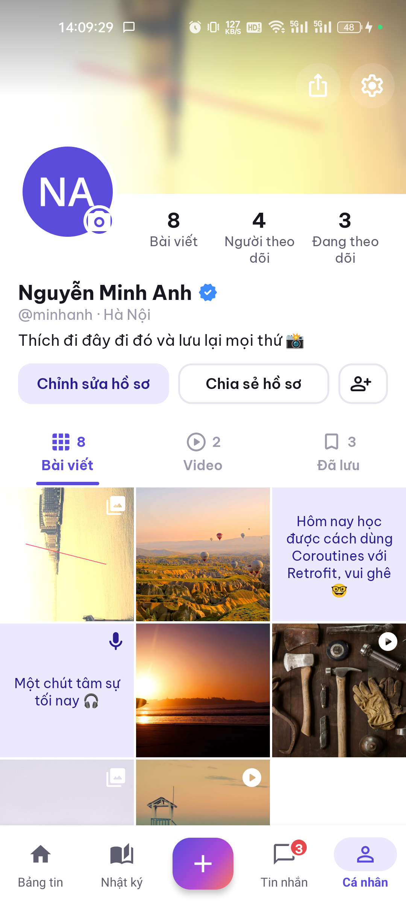<br/><sub><b>S21 · Profile (`ViewPager2` + Blur)</b></sub></td>
    <td align="center"><br/><sub><b>S22 · Cài đặt (Dark Mode)</b></sub></td>
  </tr>
  <tr>
    <td align="center">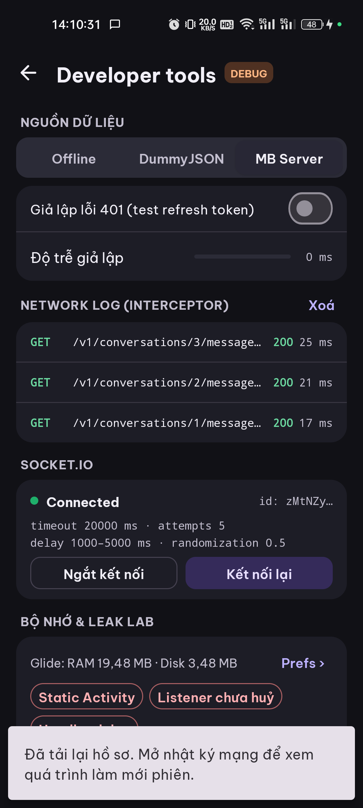<br/><sub><b>S23 · Developer Tools (`src/debug/`)</b></sub></td>
    <td align="center" colspan="2">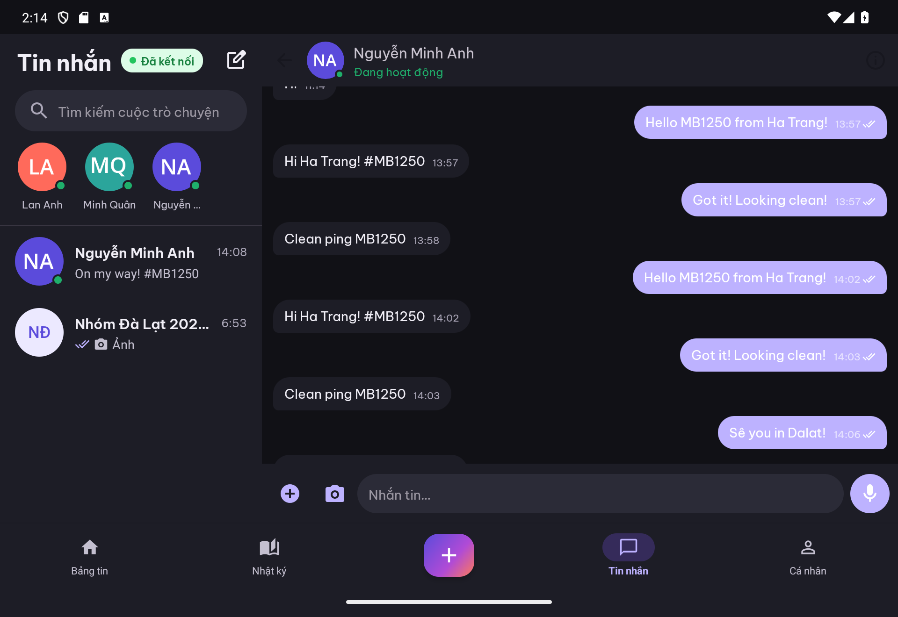<br/><sub><b>S16 + S17 · Bố cục 2 cột `layout-sw600dp` (Pixel 6a · `960×660dp`)</b></sub></td>
  </tr>
</table>

---

## 4. Kết quả nghiệm thu chi tiết theo Tài liệu BA

Đối chiếu trực tiếp toàn bộ tiêu chí trong [MomentBox_Tai-lieu-BA.docx](MomentBox_Tai-lieu-BA.docx) với mã nguồn hiện tại trên nhánh `main` (cập nhật kiểm chứng ngày **26/11/2026**, bản `v1.0.0 (versionCode 12)` sau commit `1f85df9`).

### 4.1 Tổng hợp tiến độ 5 Milestone (S01 → S23)

| Milestone | Màn hình | Số tiêu chí BA | Kết quả | Bằng chứng kiểm chứng chính |
|---|---|---:|---|---|
| **M1 · Nền tảng & Xác thực** | S01, S02, S03 | 12 / 12 | ✅ **Đạt 100%** | `LoginViewModelRegressionTest`, `DebugLogPrivacyTest`, `MentorRotationAndEdgeCaseTest`, demo RMX3350 & Pixel 6a |
| **M2 · Bảng tin & Media** | S04, S04b, S05, S06 | 15 / 15 | ✅ **Đạt 100%** | `FeedDummyJsonRegressionTest`, `FeedPostOrderTest`, `comment-retry.cjs`, `MentorRotationAndEdgeCaseTest`, demo RMX3350 |
| **M3 · Nhật ký cá nhân** | S07, S07b, S08, S09 | 14 / 14 | ✅ **Đạt 100%** | `JournalRegressionTest`, `VoiceAttachmentPlaybackTest`, `JournalVoicePlaybackDeviceTest`, `M3JournalDeviceTest`, Lint `DrawAllocation = 0` |
| **M4 · Media & Tạo bài** | S10, S11, S12, S13, S14, S15 | 22 / 22 | ✅ **Đạt 100%** | `CreateMediaRegressionTest`, `CreateControlsTest`, `ComposeMediaAdapterTest`, `PostRetryTest`, `post-retry.cjs`, demo RMX3350 |
| **M5 · Realtime, IPC & Nền** | S16, S17, S18, S19, S20, S21, S22, S22b, S23 | 33 / 33 | ✅ **Đạt 100%** | `ChatPlayerReminderRegressionTest`, `PlayerFocusPolicyTest`, `PlayerQueueTest`, `ReminderSystemEventTest`, `ReminderWriteMoodDeviceTest`, `ReminderNotificationDeviceTest`, `JournalExportCodecTest`, `ProfileOfflineLogoutRegressionTest`, `HistoryLoadingTest`, `M5PlatformContractTest`, Release DEX Audit |
| **Tổng cộng (Mục 6–12 BA)** | **26 màn hình / biến thể** | **96 / 96** | ✅ **100% Đạt** | **90/90 unit test · 51/51 mock-server test · 0 Lint errors · 0 Release debug symbols · kiểm thử live 2 thiết bị (26/11/2026)** |

---

### 4.2 Checklist nghiệm thu chi tiết từng màn hình (S01 → S23)

<details>
<summary><b>Milestone 1 — S01 Splash, S02 Onboarding, S03 Đăng nhập (12/12 Đạt)</b></summary>

#### S01 · Splash
- ✅ **Android 12+ không bị "splash kép"**: Dùng `installSplashScreen()` (`androidx.core:core-splashscreen`) + `values-v31/themes.xml` giữ màn bằng `setKeepOnScreenCondition`.
- ✅ **Back từ màn tiếp theo không quay lại Splash**: `SplashActivity` gọi `finish()` ngay sau khi điều hướng sang Onboarding / Auth / Main.
- ✅ **Mất mạng vẫn vào được app trong tối đa 3 giây**: `GET /v1/config` giới hạn timeout 3 giây, lỗi mạng dùng cache gần nhất và đi tiếp.
- ✅ **Đọc `config` và `prefs` song song**: Thực hiện bằng `async` + `await` đồng thời trong `SplashViewModel`.

#### S02 · Onboarding
- ✅ **Dùng `ViewPager` + `PagerAdapter` tự viết** (để so sánh trực tiếp với `ViewPager2` ở S21): Triển khai tại `OnboardingActivity` & `OnboardingPagerAdapter`.
- ✅ **Indicator chạy theo ngón tay (`positionOffset`)**: Custom view `PageIndicatorView` vẽ bằng Canvas co giãn mượt từ 8dp ↔ 24dp trong `onPageScrolled`.
- ✅ **Đổi ngôn ngữ vẫn giữ trang đang xem**: Dùng chung dialog ngôn ngữ S22b (`AppCompatDelegate.setApplicationLocales`), bảo toàn vị trí trang sau khi recreate Activity (đã quay chứng minh trong video M1).
- ✅ **Mở lại app không còn hiện onboarding**: Lưu cờ `onboarding_done = true` vào `SettingsDataStore`.

#### S03 · Đăng nhập
- ✅ **Sai mật khẩu hiện đúng thông báo theo ngôn ngữ app**: `LanguageInterceptor` gửi `Accept-Language: vi|en|ja` và parse `errorBody()` bằng Gson.
- ✅ **Bấm Đăng nhập liên tục chỉ gửi một request**: Nút bị vô hiệu hóa khi đang tải + chặn double-submit trong `LoginViewModel`.
- ✅ **Xoay màn hình không mất dữ liệu đang nhập và trạng thái loading**: Lưu state qua `LoginViewModel` + `SavedStateHandle`, giữ `KEY_PASSWORD_VISIBLE` và đặt `saveEnabled="false"` trên ô mật khẩu (`MentorRotationAndEdgeCaseTest`).
- ✅ **Unit test `LoginViewModel`**: Kiểm tra đầy đủ validate email/mật khẩu, trạng thái loading/success/error và hành vi DummyJSON trong [`LoginViewModelRegressionTest.kt`](MomentBox_App/app/src/test/java/com/ntq/training/momentbox/feature/auth/LoginViewModelRegressionTest.kt).

</details>

<details>
<summary><b>Milestone 2 — S04, S04b Bảng tin, S05 Chi tiết bài viết, S06 Video Player (15/15 Đạt)</b></summary>

#### S04 · Bảng tin
- ✅ **Cuộn 200 item mượt, tái sử dụng ViewHolder**: Dùng `ListAdapter` + `DiffUtil` với 7 `viewType` (`STORY_BAR`, `POST_PHOTO`, `POST_VIDEO`, `POST_VOICE`, `POST_TEXT`, `SUGGESTIONS`, `LOADING_FOOTER`) và `PhotoAlbumAdapter` dùng `DiffUtil`.
- ✅ **Thích chỉ cập nhật nút tim (payload), ảnh không nháy**: Ghi đè `getChangePayload()` và `onBindViewHolder(holder, position, payloads)`.
- ✅ **Giữ vị trí cuộn ngang của story/gợi ý khi cuộn dọc**: Lưu/khôi phục `LayoutManager.onSaveInstanceState()` và dùng chung `RecycledViewPool`.
- ✅ **Chuyển tab rồi quay lại giữ vị trí cuộn**: `MainActivity` quản lý 4 tab bằng `supportFragmentManager` (`add/show/hide`) và lưu `KEY_ACTIVE_TAB_TAG` khi xoay màn.

#### S04b · Bảng tin (cuộn xuống)
- ✅ **Cùng lúc tối đa 1 ExoPlayer và 1 MediaPlayer**: Quản lý tập trung qua `FeedVideoPlayerManager` và `VoicePlayerManager`.
- ✅ **Video cuộn ra khỏi màn hình thì dừng; quay lại phát tiếp đúng vị trí**: Tính tỉ lệ hiển thị viewport và lưu vị trí phát theo `postId`.
- ✅ **Bật tiếng video khi giọng nói đang phát → giọng nói dừng**: Xin AudioFocus qua `AndroidPlaybackAudio` / `handleAudioFocus = true`.
- ✅ **Thoát màn hình không leak player**: Release trong lifecycle callback; chạy trên Realme ghi nhận `0 APPLICATION LEAKS` trên LeakCanary.

#### S05 · Chi tiết bài viết
- ✅ **Thích/lưu ở S05 hiển thị đúng khi Back về S04**: Đồng bộ qua cùng `FeedRepository` reactive state.
- ✅ **Có đủ 2 bố cục so sánh (Layout A `NestedScrollView` và Layout B `ConcatAdapter`)**, bản chính dùng `ConcatAdapter` chỉ bind bình luận đang hiển thị.
- ✅ **Bình luận phân trang 20 item/trang**: Kèm phân trang phản hồi (`item_reply_page.xml`), tôn trọng `allowComments`, chống trùng bình luận khi retry bằng `clientId` (`mock-server/test/comment-retry.cjs`) và `mergeServerPage` / `inFlightParentBaseCounts` chống race condition.

#### S06 · Trình phát video (ngang)
- ✅ **Xoay màn hình phát tiếp đúng vị trí, đúng tốc độ**: Bảo toàn `position`, `playWhenReady`, `speed` qua ViewModel/`SavedStateHandle`, xử lý `Player.STATE_ENDED` để Replay tức thì và bàn giao vị trí về Feed khi `handleBack()`.
- ✅ **Phát được cả MP4 và HLS (`.m3u8`)**: Dùng `media3-exoplayer` + `media3-exoplayer-hls`.
- ✅ **Rút tai nghe hoặc có cuộc gọi thì tạm dừng**: Cấu hình `handleAudioFocus = true` và `setHandleAudioBecomingNoisy(true)`.
- ✅ **Có `layout-land` riêng, không dùng `configChanges`**: Kiểm chứng tại [`layout-land/activity_video_player.xml`](MomentBox_App/app/src/main/res/layout-land/activity_video_player.xml) và trên Realme (`m2_video_landscape.png`).

</details>

<details>
<summary><b>Milestone 3 — S07, S07b Nhật ký, S08 Viết nhật ký, S09 Thống kê (14/14 Đạt)</b></summary>

#### S07 · Nhật ký
- ✅ **Lịch tính đúng ngày đầu tháng (1/10/2026 là Thứ Năm) và tháng 2 năm nhuận**: `MoodCalendarView` tự vẽ bằng Canvas, kiểm thử bằng `JournalRegressionTest` và `M3JournalDeviceTest`.
- ✅ **Thêm/sửa/xóa ở S08 thì S07 tự cập nhật**: Quan sát trực tiếp `Flow` từ `JournalDao` (Room).
- ✅ **Hoàn tác xóa trong 5 giây hoạt động**: Xóa mềm `deleted_at` + Snackbar *Hoàn tác* 5 giây, hết hạn mới xóa thật kèm file đính kèm.
- ✅ **Chạy lọc/sắp xếp & tìm kiếm bằng SQL (bổ sung `FTS4`)**: Có thể đối chiếu trực tiếp bảng `journal_entries` trên Database Inspector.

#### S07b · Lọc & sắp xếp (BottomSheet)
- ✅ **Xoay màn hình không mất lựa chọn đang dở**: Lưu trạng thái filter qua `SavedStateHandle` / state restoration (`MentorRotationAndEdgeCaseTest`).
- ✅ **Số kết quả trên nút Áp dụng khớp số item sau khi áp dụng**: Đếm trước bằng `SELECT COUNT(*)` mỗi khi đổi điều kiện và trả kết quả qua `Fragment Result API`.
- ✅ **Lọc và sắp xếp chạy hoàn toàn trong SQL**: Truy vấn động trong `JournalDao`, không lọc trên RAM.

#### S08 · Viết nhật ký
- ✅ **Kill app khi đang viết, mở lại khôi phục được nháp**: Tự lưu nháp JSON (debounce 2s) vào `DataStore`; mở lại hiện hộp thoại *"Khôi phục bản nháp"* (`Bỏ qua` / `Khôi phục`).
- ✅ **Âm thanh nền lặp liền mạch, không giật khi gõ phím**: `AudioTrack MODE_STREAM` đọc WAV PCM 16-bit 22050Hz theo khối trên `Dispatchers.IO`, hỗ trợ chọn *Tiếng mưa* / *Tiếng biển* và chỉnh âm lượng.
- ✅ **Entry và attachments lưu trong một `@Transaction`**: Đảm bảo toàn vẹn dữ liệu giữa `journal_entries`, `journal_attachments` và `journal_tags`.
- ✅ **Xóa ảnh gốc khỏi Gallery thì ảnh đính kèm vẫn xem được**: Copy file ảnh vào `filesDir/journal/` thay vì giữ URI tạm.

#### S09 · Thống kê nhật ký
- ✅ **Unit test chuỗi ngày (có ngày trống, qua tháng, qua năm)**: Kiểm thử đầy đủ trong [`JournalRegressionTest.kt`](MomentBox_App/app/src/test/java/com/ntq/training/momentbox/feature/journal/JournalRegressionTest.kt) với `JournalStatsCalculator` thuần Kotlin.
- ✅ **Hai biểu đồ tự vẽ bằng Canvas, không dùng thư viện chart**: `DonutChartView` và `LineChartView` (đạt **0 `DrawAllocation`** trong `onDraw()` theo Android Lint).
- ✅ **Đổi kỳ cập nhật mượt trên `Dispatchers.Default`**: Tối ưu bằng `getStatsSnapshot()` + `requestRevision` tránh ghi đè kết quả bất đồng bộ cũ.

</details>

<details>
<summary><b>Milestone 4 — S10 Gallery, S11 CameraX, S12 Crop, S13 Editor, S14 Ghi âm, S15 Đăng bài (22/22 Đạt)</b></summary>

#### S10 · Chọn ảnh & video (`MediaStore`)
- ✅ **Phân nhánh quyền đúng theo API Android (≤ 12, 13, 14+ quyền đầy đủ & chọn một phần)**: Có banner *Quản lý* khi chỉ có `READ_MEDIA_VISUAL_USER_SELECTED`.
- ✅ **Không dùng thư viện picker bên thứ ba**: Tự truy vấn `ContentResolver` + `MediaStore`, nhóm album bằng `groupBy`.
- ✅ **Tự làm mới khi có ảnh mới từ Camera hệ thống**: `ContentObserver` bọc `callbackFlow` + `awaitClose { unregister }` trong [`MediaStoreRepository.kt`](MomentBox_App/app/src/main/java/com/ntq/training/momentbox/data/local/mediastore/MediaStoreRepository.kt).
- ✅ **Cuộn danh sách ảnh lớn mượt, không OOM**: Phân trang 60 item/lần, Glide thumbnail `override(240)` + `signature(DATE_MODIFIED)`.

#### S11 · Camera (`CameraX`)
- ✅ **Bộ lọc realtime tái sử dụng Bitmap, không cấp phát mỗi frame**: `RgbaAnalyzer` (`STRATEGY_KEEP_ONLY_LATEST`, `RGBA_8888`, 720p) + `ColorMatrix` (`PhotoFilters`).
- ✅ **Ảnh chụp ra đúng hướng EXIF và đúng bộ lọc đã chọn**: Đọc EXIF + áp dụng cùng `ColorMatrix` ở độ phân giải đầy đủ.
- ✅ **Pinch zoom, chạm lấy nét/phơi sáng, có `layout-land` riêng**: `ScaleGestureDetector`, `FocusMeteringAction`, [`layout-land/fragment_camera.xml`](MomentBox_App/app/src/main/res/layout-land/fragment_camera.xml).
- ✅ **`AudioTrack MODE_STATIC` tạo một lần và `release()` khi rời màn**: [`StaticPcmSound.kt`](MomentBox_App/app/src/main/java/com/ntq/training/momentbox/core/media/StaticPcmSound.kt) nạp `sfx-shutter.wav` / `sfx-tick.wav`, kiểm chứng trên Realme qua `MentorRotationAndEdgeCaseTest#staticPcmSoundLoadsAndPlaysBothSfxAssets`.

#### S12 · Cắt & xoay ảnh
- ✅ **Ảnh kết quả đúng vùng hiển thị kể cả xoay/lật + khóa tỷ lệ khi kéo cạnh**: `CropMath` dùng ma trận nghịch đảo (`invert`), kiểm chứng thực tế trên Realme (`m4_crop_ratio.png`).
- ✅ **Ảnh độ phân giải cao (12 MP) không gây OOM**: Đọc `inJustDecodeBounds`, tính `inSampleSize` (cạnh dài ≤ 2048 px) trên `Dispatchers.Default`, quản lý file tạm qua `OwnedImageFiles`.
- ✅ **`CropOverlayView` giữ trạng thái khi xoay màn hình**: Implement `onSaveInstanceState` / `onRestoreInstanceState`.

#### S13 · Chỉnh sửa ảnh (Sticker, Vẽ, Chữ, Bộ lọc, Điều chỉnh)
- ✅ **Sticker phóng/xoay 2 ngón không nhảy khi nhấc một ngón**: `StickerCanvasView` theo dõi chính xác `pointerId` trên `ACTION_POINTER_DOWN`/`UP` và tính góc xoay bằng `atan2`.
- ✅ **Kéo thả từ khay dùng Drag & Drop framework**: `View.startDragAndDrop()` + `OnDragListener` (`ACTION_DRAG_ENTERED`, `ACTION_DROP`).
- ✅ **Ảnh lưu xong hiện trong Gallery, đúng vị trí các lớp**: `GalleryExporter` xuất JPEG vào `Pictures/MomentBox` (`IS_PENDING` cho API 29+ và `MediaScannerConnection.scanFile` bọc `suspendCoroutine` cho API < 29).
- ✅ **Undo/Redo đúng thứ tự thao tác (+ đồng bộ thanh SeekBar)**: `EditorHistory` (30 bước) kiểm thử trong [`CreateMediaRegressionTest.kt`](MomentBox_App/app/src/test/java/com/ntq/training/momentbox/feature/create/CreateMediaRegressionTest.kt).

#### S14 · Ghi âm
- ✅ **Tắt màn hình vẫn ghi tiếp; notification hiện đúng thời gian**: `RecordingService` chạy foreground (`foregroundServiceType="microphone"`), đồng bộ trạng thái & biên độ với `RecorderActivity` qua Bound Service.
- ✅ **Mất AudioFocus tự tạm dừng**: Xin `GAIN_TRANSIENT_EXCLUSIVE`; tự tạm dừng khi có cuộc gọi/âm thanh khác chiếm focus.
- ✅ **Xoay màn hình hoặc thoát Activity không làm dừng ghi**: Phối hợp mô hình Started + Bound Service và `RecordingRecoveryStore`.
- ✅ **Chạy đúng trên Android 14+**: Khai báo `FOREGROUND_SERVICE_MICROPHONE`, hiển thị nguồn micro thực tế (`RMX3350`) qua `AudioDeviceCallback`.

#### S15 · Tạo bài viết
- ✅ **Tiến trình tải lên % thật, hủy được giữa chừng**: `ProgressRequestBody` phát tiến trình byte thật; hủy cancel coroutine/OkHttp call; chống đăng trùng khi retry bằng UUID `clientId` (`PostRetryTest.kt`, `mock-server/test/post-retry.cjs`).
- ✅ **Thứ tự ảnh gửi lên server khớp thứ tự kéo sắp xếp**: `ComposeMediaAdapter` dùng `DiffUtil` + `ItemTouchHelper` (`ComposeMediaAdapterTest.kt`).
- ✅ **Bài mới xuất hiện ngay đầu Bảng tin không cần kéo làm mới**: Chèn tức thời vào `FeedRepository` + tùy chọn *Đồng thời lưu vào Nhật ký*.

</details>

<details>
<summary><b>Milestone 5 — S16–S23 Chat Realtime, Player :player AIDL, Reminder, Profile, Settings, DevTools (33/33 Đạt)</b></summary>

#### S16 · Danh sách tin nhắn
- ✅ **Offline-first**: Mở khi không có mạng vẫn hiển thị danh sách hội thoại từ Room, đồng bộ lại mỗi khi socket kết nối.
- ✅ **Tin mới lên đầu, badge tăng, không reload cả danh sách**: Cập nhật Room (`updated_at DESC`) + `DiffUtil`.
- ✅ **Cập nhật online/offline realtime**: Lắng nghe `presence:update` (kiểm thử bởi `mock-server/test/m5-presence-host.cjs`).
- ✅ **Sự kiện socket bọc `callbackFlow`, gỡ đúng `Emitter.Listener`**: `SocketIoTransport` ánh xạ wrapper để `off()` gỡ chính xác, kèm `generation` fence (`ScopedChatEvent`) chặn rò rỉ dữ liệu liên phiên.

#### S17 · Phòng chat
- ✅ **Tin gửi khi mất mạng chuyển `FAILED` sau 5s và gửi lại được cùng `clientId`**: `AckWithTimeout(5000)` + dedupe idempotent (`mock-server/test/m5-send.cjs`, `ChatPlayerReminderRegressionTest.kt`).
- ✅ **Banner kết nối hiện đúng số lần thử, tự ẩn & bù tin bị lỡ khi reconnect**: `SocketUi` + `SocketPhase` + bù lịch sử qua REST (`HistoryLoadingTest.kt`).
- ✅ **Bấm thông báo hội thoại đang mở không tạo Activity mới**: `ChatActivity` khai báo `launchMode="singleTop"` + xử lý `onNewIntent`.
- ✅ **Mở/đóng màn nhiều lần không nhận trùng tin**: Hủy đăng ký collector/listener chuẩn vòng đời.
- ✅ **Tablet hiển thị 2 cột**: [`layout-sw600dp/fragment_chat.xml`](MomentBox_App/app/src/main/res/layout-sw600dp/fragment_chat.xml) kiểm chứng trực quan trên AVD Pixel 6a chế độ tablet `960×660dp` (`m5_chat_sw600dp.png`).

#### S18 · Trình phát âm thanh (`PlayerService` + AIDL)
- ✅ **Chạy process riêng `:player`, kill process chính nhạc vẫn phát**: `android:process=":player"` + `foregroundServiceType="mediaPlayback"`, 5 file `.aidl`, `enforceOwner()` kiểm `Binder.getCallingUid()`, `RemoteCallbackList` + `oneway` callback (`M5PlatformContractTest.kt`).
- ✅ **Thoát rồi mở lại S18 hiển thị đúng trạng thái**: `PlayerClient` bind ở `onStart` và lấy snapshot qua `getState()`.
- ✅ **Rút tai nghe / mất AudioFocus tự dừng và phát tiếp đúng chính sách**: `NoisyReceiver` (`RECEIVER_NOT_EXPORTED`) + `PlayerFocusPolicy` + bắt tay `nonce` AudioFocus liên process (`PlayerFocusPolicyTest.kt`, `PlayerQueueTest.kt`).
- ✅ **Tương thích Android 8 → 14+**: `MediaSession`, `NotificationChannel`, `FOREGROUND_SERVICE_MEDIA_PLAYBACK`, đồng bộ ngôn ngữ `:player` qua `APP_LOCALES_RECORD_FILE`.

#### S19 · Thông báo hệ thống
- ✅ **Android 13+ xin `POST_NOTIFICATIONS`, không crash khi bị từ chối**: Có màn giải thích (`NotificationPermissionDialog`) và trạng thái fallback rõ ràng.
- ✅ **Trả lời trực tiếp từ thông báo (Direct Reply) gửi được tin**: `ChatActionReceiver` (`exported="false"`) → `NotificationReplySender` (thử Socket ACK 1.5s → tự động fallback REST `POST v1/conversations/{id}/messages`).
- ✅ **Bấm thông báo chat khi app bị kill mở đúng hội thoại, Back về Main**: Dựng back stack bằng `TaskStackBuilder` (`Main → Chat`).

#### S20 · Nhắc viết nhật ký (full-screen)
- ✅ **Màn khóa hiện full-screen đúng giờ (kèm fallback `INEXACT` nếu thiếu `SCHEDULE_EXACT_ALARM`)**: `ReminderScheduler` tuần tự hóa bằng `Mutex`, `ReminderRingingService` + `ReminderActivity` (`ReminderNotificationDeviceTest.kt`, `m5_reminder.png`).
- ✅ **Khởi động lại máy / đổi giờ / đổi múi giờ vẫn giữ lịch**: `ReminderRescheduleReceiver` dùng `goAsync()` (`ReminderSystemEventTest.kt`), đồng thời bảo toàn lịch sau khi đổi ngôn ngữ app.
- ✅ **`ReminderActivity` không nằm trong Recents và không trộn vào task chính**: `launchMode="singleInstance"`, `excludeFromRecents="true"`, `taskAffinity="${applicationId}.reminder"`.
- ✅ **Hôm nay đã viết nhật ký thì không nhắc**: Kiểm tra Room trong `ReminderAlarmReceiver` trước khi phát chuông và tự lên lịch ngày kế tiếp.

#### S21 · Trang cá nhân
- ✅ **Dùng `ViewPager2` + `FragmentStateAdapter(this)` (`childFragmentManager`)**: Quản lý vòng đời 3 tab con (*Bài viết*, *Video*, *Đã lưu*) gắn liền vòng đời `ProfileFragment`.
- ✅ **Đổi avatar cập nhật ngay ở S21 và S04**: Dùng Glide `ObjectKey` bỏ cache cũ sau ACK (`mock-server/test/m5-profile.cjs`).
- ✅ **Vuốt mượt giữa các tab, mỗi tab giữ vị trí cuộn**: `offscreenPageLimit = 1`, `AppBarLayout` cuộn mượt, `QuarterBlurTransformation` làm mờ ảnh bìa tiết kiệm RAM.

#### S22 & S22b · Cài đặt & Chọn ngôn ngữ
- ✅ **Mọi thiết lập lưu bằng `DataStore`, đọc bằng `Flow`**: Không dùng `runBlocking` trên Main Thread.
- ✅ **Xóa bộ nhớ đệm ảnh Glide cập nhật dung lượng thực tế**: `ImageCacheRepository` tính & xóa disk cache trên `Dispatchers.IO` + memory cache trên Main.
- ✅ **Xuất nhật ký JSON parse ngược chuẩn dữ liệu**: `JournalExportCodec` với `ExportInstantAdapter` (ISO-8601 UTC) kiểm thử bởi [`JournalExportCodecTest.kt`](MomentBox_App/app/src/test/java/com/ntq/training/momentbox/feature/settings/JournalExportCodecTest.kt).
- ✅ **Đăng xuất xong bấm Back không quay lại màn cũ**: `LogoutCoordinator` chạy trên `Application` scope (xoay màn không hủy dở), dọn tuần tự từng bước độc lập (token, socket, upload, recorder, `:player` IPC, reminder, cache scoped theo SHA-256, giữ nhật ký nếu chọn) rồi mở S03 với `CLEAR_TASK` (`ProfileOfflineLogoutRegressionTest.kt`, `logout-config.cjs`).
- ✅ **Đổi ngôn ngữ (`vi` / `en` / `ja`) áp dụng ngay cả thông báo lỗi server**: `AppCompatDelegate.setApplicationLocales` + `locales_config.xml` + `LanguageInterceptor`.
- ✅ **Android 13+ đồng bộ Cài đặt hệ thống & định dạng ngày/giờ/số theo locale**: Khai báo `android:localeConfig="@xml/locales_config"` và `bundle { language { enableSplit = false } }`.

#### S23 · Developer tools (chỉ bản Debug)
- ✅ **APK Release không chứa `DevToolsActivity`, `LeakLabActivity`, `LeakCanary`**: Toàn bộ đặt trong `src/debug/` + `debugImplementation`; kiểm toán `app-release-unsigned.apk` (Manifest & 3 file DEX) = **0** symbol debug.
- ✅ **Giả lập lỗi 401 thấy chuỗi `401 → refresh → retry 200` trong Network Log**: `DebugHeaderInterceptor` + `NetworkLogInterceptor` (ring buffer 100 request) + `TokenAuthenticator`.
- ✅ **Leak Lab 3 kịch bản (Static Activity, Listener chưa hủy, Handler delay)**: [`LeakLabActivity.kt`](MomentBox_App/app/src/debug/java/com/ntq/training/momentbox/debug/LeakLabActivity.kt) tích hợp LeakCanary để thực hành tìm & phân tích GC root.

</details>

---

### 4.3 Bản đồ phủ 19 chủ đề kiến thức (Mục 2 BA) & Công cụ Android Studio (Mục 14.1 BA)

<details>
<summary><b>Xem đối chiếu đầy đủ 19 dòng kiến thức & 7 công cụ Android Studio + Tương thích API 24–36</b></summary>

#### Bản đồ phủ 19 chủ đề kiến thức (Mục 2 BA)

| # | Chủ đề BA | Triển khai thực tế trong `MomentBox_App` | Trạng thái |
|---:|---|---|---|
| 1 | Kotlin · Generic (`in`/`out`/`where`) | `BaseActivity<VB>`, `BaseFragment<VB>`, `BaseListAdapter<T, VB>`, `ApiResponse<T>`, `UiState<out T>`, `Mapper<in I, out O>` | ✅ Đạt |
| 2 | Kotlin · Collection API | `JournalStatsCalculator` (`groupBy`, `groupingBy().eachCount()`, `sumOf`, `maxByOrNull`, `flatMap`, `zipWithNext`), `MediaStoreRepository` | ✅ Đạt |
| 3 | Kotlin · Coroutines & Flow | `viewModelScope`, `repeatOnLifecycle(STARTED)`, `callbackFlow` (Socket/Network/ContentObserver), `suspendCancellableCoroutine`, `async/await`, `Dispatchers.IO/Default`, 0 `GlobalScope` | ✅ Đạt |
| 4 | Activity: Task, LaunchMode, Đa ngôn ngữ | `MainActivity` (`singleTask`), `ChatActivity`/`PlayerActivity` (`singleTop`), `ReminderActivity` (`singleInstance` + `taskAffinity` riêng), `AppCompatDelegate.setApplicationLocales` | ✅ Đạt |
| 5 | Service: AIDL, FGS, PendingIntent, Full-screen | `PlayerService` (`:player` + AIDL), `RecordingService` (`microphone`), `ReminderRingingService` (`mediaPlayback`), `FLAG_IMMUTABLE` / `FLAG_MUTABLE` (RemoteInput) | ✅ Đạt |
| 6 | BroadcastReceiver | `NoisyReceiver` (`RECEIVER_NOT_EXPORTED`), `ReminderAlarmReceiver`, `ReminderRescheduleReceiver` (`BOOT_COMPLETED`, `TIME_SET`, `TIMEZONE_CHANGED`, `MY_PACKAGE_REPLACED`), `ChatActionReceiver` | ✅ Đạt |
| 7 | Content Provider | `MediaStoreRepository` (S10), `GalleryExporter` (`IS_PENDING`, S13), `JournalDownloadWriter` (`MediaStore.Downloads`, S22), `CreateMediaFileProvider` | ✅ Đạt |
| 8 | View, CustomView, Canvas, Touch, Multi-touch, Drag & Drop | `PageIndicatorView`, `WaveformView`, `MoodCalendarView`, `DonutChartView`, `LineChartView`, `CropOverlayView`, `StickerCanvasView`, `RecorButton`, `RecordingWaveformView`, `PlayerChipRow`; `layout-land`, `layout-sw600dp`, `values-night`, `values-v31` | ✅ Đạt |
| 9 | Fragment & DialogFragment | `supportFragmentManager` (`add/show/hide`) cho 4 tab chính, `childFragmentManager` cho S21 `ViewPager2`, `BottomSheetDialogFragment`, `DialogFragment`, Fragment Result API | ✅ Đạt |
| 10 | MVVM | Tách biệt rõ UI → ViewModel (`StateFlow`/`SharedFlow`/`SavedStateHandle`) → Repository → DataSource | ✅ Đạt |
| 11 | RecyclerView | Feed 7 `viewType`, list-in-list dùng chung `RecycledViewPool`, `ListAdapter` + `DiffUtil` + payload, so sánh `NestedScrollView` vs `ConcatAdapter`, 0 `notifyDataSetChanged()` | ✅ Đạt |
| 12 | ViewPager, ViewPager2, TabLayout | S02 `ViewPager` + `PagerAdapter` tự viết; S04/S05 album `ViewPager2`; S21 `ViewPager2` + `FragmentStateAdapter` + `TabLayoutMediator` + custom tab | ✅ Đạt |
| 13 | Data Storage | `SettingsDataStore` / `PostDraftStore` / `ReminderStore` + `AppDatabase` (Room 7 bảng + `FTS4`, truy vấn lọc/sort trong SQL) | ✅ Đạt |
| 14 | Design | Font `Be Vietnam Pro`, icon Vector Asset, hệ màu semantic `values/` & `values-night/`, lưới 4dp, edge-to-edge `WindowInsets` | ✅ Đạt |
| 15 | Android Studio Tools | `DevToolsActivity` + `LeakLabActivity` (S23), LeakCanary sạch runtime, APK Release audit sạch debug | ✅ Đạt / 🛠️ Demo trực tiếp |
| 16 | Glide, Gson, Retrofit, Socket.IO | Glide (`circleCrop`, `ObjectKey`, `QuarterBlurTransformation`), Gson (`JsonDeserializer` feed đa kiểu, `ExportInstantAdapter`), Retrofit (5 interceptor + `TokenAuthenticator`), Socket.IO (backoff + ACK + fallback REST) | ✅ Đạt |
| 17 | Ảnh, Video, Camera | S10 `MediaStore`, S11 CameraX + `ImageAnalysis` filter realtime, S12 Crop `Matrix`, S04b/S06 Media3 ExoPlayer (MP4 & HLS) | ✅ Đạt |
| 18 | Audio & Recorder | `MediaPlayer` (Feed voice/Chat voice/PlayerService), `AudioTrack MODE_STATIC` (`StaticPcmSound`), `AudioTrack MODE_STREAM` (âm thanh nền S08), `MediaRecorder` (S14/S17) | ✅ Đạt |
| 19 | Audio Focus | `AndroidPlaybackAudio`, `PlayerFocusPolicy`, `PlayerAudioBridge` (bắt tay `nonce` giữa process chính và `:player`) | ✅ Đạt |

#### Checklist công cụ Android Studio (Mục 14.1 BA) & Tương thích API 24 → 36 (Mục 15 BA)

- ✅ **APK Analyzer (Release Audit):** Đã kiểm toán `app-release-unsigned.apk` (Manifest & 3 file DEX) — **0** dấu vết `DevToolsActivity`, `LeakLabActivity`, `LeakCanary`.
- ✅ **LeakCanary:** Chạy kiểm thử toàn bộ luồng app trên Realme RMX3350 — **0** `APPLICATION LEAKS`.
- 🛠️ **Các công cụ trình diễn trực tiếp trên Android Studio khi bảo vệ:** Database Inspector (`journal_entries`), Network Inspector (chuỗi `401 → refresh → retry`), Device Explorer (`files/datastore/`, `cache/image_manager_disk_cache/`, `files/journal/`), Memory Profiler (`LeakLabActivity`), Layout Inspector & Conditional Breakpoint (`TokenAuthenticator`) đều đã được chuẩn bị sẵn màn hình & dữ liệu để trình diễn trực tiếp cùng mentor.
- ✅ **Tương thích Android 7.0 (API 24) → Android 16 (API 36):** `FileProvider`, Notification Channels (API 26+), `network_security_config` tách debug/release (API 28+), Scoped Storage `IS_PENDING` (API 29+), `foregroundServiceType` + quyền tương ứng (API 30–34+), `FLAG_IMMUTABLE`/`SCHEDULE_EXACT_ALARM`/SplashScreen API (API 31+), `POST_NOTIFICATIONS`/`READ_MEDIA_*`/per-app language (API 33+), `READ_MEDIA_VISUAL_USER_SELECTED`/`RECEIVER_NOT_EXPORTED`/`canUseFullScreenIntent()` (API 34+), Edge-to-edge `WindowInsets` (API 35+), `OnBackPressedDispatcher` predictive back & adaptive `sw600dp` (API 36).

</details>

---

## 5. Cấu trúc Repository

| Thư mục / File | Nội dung |
|---|---|
| [`MomentBox_App/`](MomentBox_App/) | Mã nguồn ứng dụng Android (Kotlin + XML + ViewBinding): `app/src/main/java/.../` (`core/`, `data/`, `domain/`, `feature/`), `app/src/main/aidl/` (5 file AIDL cho `:player`), `app/src/debug/` (`DevToolsActivity`, `LeakLabActivity`, `DebugGlideModule`, debug `network_security_config.xml`), `app/src/test/` (Unit tests) và `app/src/androidTest/` (Instrumented tests). |
| [`mock-server/`](mock-server/) | Backend giả lập miễn phí (Node.js + Express + Socket.IO 4 + Multer + tự sinh file WAV mẫu), kèm bộ test tự động. Xem chi tiết API & Socket events tại [`mock-server/README.md`](mock-server/README.md). |
| [`docs/media/`](docs/media/) | Bộ 22 ảnh chụp màn hình thật ([`screenshots/`](docs/media/screenshots/)) nhúng trong README này (5 video demo được phát trực tuyến qua YouTube). |
| [`mockups/`](mockups/) | 26 mockup thiết kế chuẩn (720×1560), gồm bản sạch, `annotated/` (đánh số khớp BA), `pairs/` và `boards/` (7 board theo nhóm + `00_Tong-quan.png`). |
| [`mockup-src/`](mockup-src/) | Mã nguồn HTML tạo bộ mockup (chỉnh `src/*.html` rồi chạy `node render.js` để xuất lại ảnh). |
| [`MomentBox_Tai-lieu-BA.docx`](MomentBox_Tai-lieu-BA.docx) | Tài liệu đặc tả nghiệp vụ & tiêu chí nghiệm thu bản đầy đủ (S01 → S23). |

---

## 6. Hướng dẫn Cài đặt & Chạy ứng dụng

### Yêu cầu môi trường
- **Android Studio** (khuyến nghị bản hỗ trợ AGP `9.2.0`), **JDK 17**, **Android SDK 36**.
- **Node.js `>= 18`** (để chạy `mock-server`).

### Bước 1 — Khởi chạy Mock Server

```bash
cd mock-server
npm install
npm start
```

Kiểm tra nhanh toàn bộ API đang hoạt động:

```bash
node test/smoke.js http://localhost:3000
```

*(Tùy chọn: đặt `ACCESS_TOKEN_TTL=60` để kiểm thử chu kỳ tự động refresh token nhanh hơn).*

### Bước 2 — Build & cài đặt Android App (`MomentBox_App/`)

#### A. Chạy trên Android Emulator (mặc định `http://10.0.2.2:3000/`)

```powershell
cd MomentBox_App
.\gradlew.bat :app:installDebug
```

#### B. Chạy trên Thiết bị thật qua cáp USB (khuyến nghị khi demo)

Bật **USB Debugging**, nối cáp USB và chuyển tiếp cổng 3000:

```powershell
adb reverse tcp:3000 tcp:3000
cd MomentBox_App
.\gradlew.bat :app:installDebug "-PmomentboxBaseUrl=http://127.0.0.1:3000/"
```

*(Nếu dùng cùng mạng Wi-Fi không cắm cáp, truyền `-PmomentboxBaseUrl=http://<IP_LAN_MAY_TINH>:3000/` và thêm IP vào `app/src/debug/res/xml/network_security_config.xml`).*

#### C. Build bản Release (bắt buộc HTTPS)

Bản Release yêu cầu URL HTTPS thực tế của backend theo môi trường qua biến môi trường `MOMENTBOX_RELEASE_BASE_URL` hoặc Gradle property `-PmomentboxReleaseBaseUrl`. URL bắt buộc phải dùng `https://`, có hostname hợp lệ, kết thúc bằng `/` và không chứa credentials, query hay fragment — build sẽ tự dừng nếu thiếu hoặc sai định dạng:

```powershell
cd MomentBox_App
.\gradlew.bat :app:assembleRelease "-PmomentboxReleaseBaseUrl=https://api.momentbox.dev/"
```

### Tài khoản demo & 3 nguồn dữ liệu

| Nguồn dữ liệu | Tài khoản / Mật khẩu | Ghi chú |
|---|---|---|
| **MB Server** *(khuyên dùng)* | `minhanh@momentbox.dev` / `123456` *(chính)*<br/>`lananh@momentbox.dev`, `quan@momentbox.dev` / `123456` *(Bot tự trả lời chat)*<br/>`travel@momentbox.dev`, `trang@momentbox.dev`, `khang@momentbox.dev`, `linh@momentbox.dev` / `123456` | Hỗ trợ đầy đủ REST, Socket.IO realtime, Upload multipart, Audio WAV mẫu và endpoint Debug (S23). Có thể bấm nút **Dùng tài khoản demo** ở S03. |
| **DummyJSON** | `emilys` / `emilyspass` | REST public (`https://dummyjson.com/`), không cần chạy mock-server (không có Socket.IO / upload). |
| **Offline Mode** | Bấm **Dùng tài khoản demo** | Chạy cục bộ qua `MockInterceptor` + Room, không cần kết nối mạng. |

---

## 7. Kiểm thử & Bảng số liệu chất lượng

Các lệnh kiểm thử chuẩn chạy từ thư mục `MomentBox_App/` và `mock-server/`:

```powershell
# 1. Local Unit Tests (JUnit 4 + Coroutines Test + MockWebServer)
cd MomentBox_App
.\gradlew.bat :app:testDebugUnitTest

# 2. Instrumentation Tests trên thiết bị thật / emulator
.\gradlew.bat :app:connectedDebugAndroidTest

# 3. Android Lint kiểm tra code, layout, overdraw, draw allocation
.\gradlew.bat :app:lintDebug

# 4. Kiểm thử Mock Server (regression + smoke test)
cd ..\mock-server
node --test test/comment-retry.cjs test/logout-config.cjs test/m5-following.cjs test/m5-profile.cjs test/m5-send.cjs test/post-retry.cjs
node test/smoke.js http://127.0.0.1:3000
```

### Kết quả kiểm chứng mới nhất (ngày 26/11/2026 · `v1.0.0` / `versionCode 12`)

| Hạng mục kiểm chứng | Phạm vi / Thiết bị | Kết quả thực tế |
|---|---|---|
| **Android Lint (`:app:lintDebug`)** | Toàn bộ mã nguồn, XML layout & tài nguyên | **0 errors · 40 warnings** (40 cảnh báo 100% là gợi ý nâng phiên bản AGP/SDK/thư viện cố định theo BA: `GradleDependency: 27`, `NewerVersionAvailable: 11`, `OldTargetApi: 1`, `AndroidGradlePluginVersion: 1`; **0** Overdraw / `DrawAllocation` / `NotifyDataSetChanged` / layout / logic) |
| **Local Unit Tests** | `:app:testDebugUnitTest` (18 file test) | **90 / 90 PASS** (bao gồm `VoiceAttachmentPlaybackTest`, `JournalRegressionTest`, `CreateMediaRegressionTest`, `ReminderSystemEventTest`) |
| **Instrumentation Tests** | Thiết bị thật **Realme RMX3350** (`src/androidTest/`) | **3 / 3 PASS** cho các ca thiết bị mới bổ sung (`JournalVoicePlaybackDeviceTest`, `ReminderWriteMoodDeviceTest` kiểm chứng `K18`); bộ hồi quy thiết bị trước đó trên RMX3350 đạt **37 / 37 PASS** (tổng 40 ca trong `src/androidTest/`) |
| **Mock Server Tests** | `node --test` (6 suite) & `node test/smoke.js` | **17 / 17 PASS** + **34 / 34 PASS** (**51 / 51 PASS**) |
| **Release Security Audit (S23)** | Quét `AndroidManifest.xml` & toàn bộ `classes*.dex` trong `app-release-unsigned.apk` (`10.34 MB`) | **0** dấu vết `DevToolsActivity`, `LeakLabActivity`, `LeakCanary` |
| **Kiểm thử kịch bản live (M1–M5)** | **Realme RMX3350** (Minh Anh) + **AVD Pixel 6a** (Hà Trang) · phiên `MB1250` | **30 / 30 Đạt** toàn bộ ca demo trực tiếp `D01–D30` (bao gồm hẹn giờ nhắc màn khóa `D24` lúc `14:52:02` và bỏ nhắc `D25` lúc `14:36` tự dời sang ngày hôm sau), bộ 22 ảnh chụp màn hình & 5 video demo (26–27/11/2026); 0 crash runtime |

---

## 8. Điểm nhấn Bảo mật & Engineering

- **Cách ly tuyệt đối mã Debug khỏi bản Release:** `DevToolsActivity`, `LeakLabActivity`, `DebugGlideModule` và `network_security_config.xml` cho phép HTTP nội bộ đều nằm riêng trong source set `src/debug/`; `LeakCanary` chỉ khai báo `debugImplementation`; bản Release ép dùng HTTPS qua Gradle validation và cấm cleartext HTTP.
- **Bảo mật log & phiên xác thực:** `DebugLogPrivacy` che nhạy cảm `Authorization`/`Cookie`/token (có `DebugLogPrivacyTest`), `TokenAuthenticator` đồng bộ khóa refresh 1 lần khi nhiều request 401 đồng thời, ô mật khẩu đặt `saveEnabled="false"`.
- **An toàn IPC đa tiến trình (`:player`):** `PlayerService` đặt `android:exported="false"`, mọi lệnh Binder đi qua `enforceOwner()` (`Binder.getCallingUid() != Process.myUid()`), callback dùng `oneway` + `RemoteCallbackList` tránh deadlock & leak khi UI process chết, phối hợp AudioFocus liên process bằng `nonce`.
- **Chống trùng dữ liệu & race condition:** Áp dụng `clientId` idempotent cho cả đăng bài (S15), gửi bình luận (S05) và gửi tin nhắn/Direct Reply (S17/S19); gắn `generation` fence (`ScopedChatEvent`) chặn dữ liệu phiên cũ ghi nhầm vào Room khi đổi tài khoản.
- **Đăng xuất nguyên tử không bị hủy bởi xoay màn hình:** `LogoutCoordinator` chạy ở `Application` scope, bọc từng bước cleanup độc lập (`AUTH`, `SOCKET`, `CHAT_SENDS`, `REPLIES`, `POST_UPLOAD`, `RECORDER`, `PLAYER_IPC`, `REMINDER`, xóa cache theo thư mục hash SHA-256 kiểm tra `canonicalFile`, giữ nguyên file đính kèm nhật ký nếu người dùng chọn giữ).

---

## 9. Tài liệu liên quan

- [Đặc tả REST API, Socket.IO & Media mẫu (`mock-server/README.md`)](mock-server/README.md)
- [Tài liệu BA & Tiêu chí nghiệm thu chi tiết (`MomentBox_Tai-lieu-BA.docx`)](MomentBox_Tai-lieu-BA.docx)
